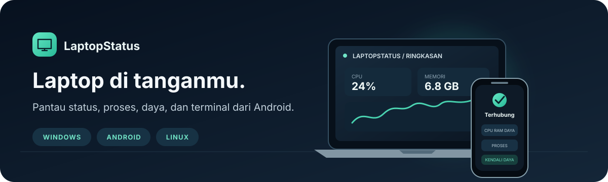
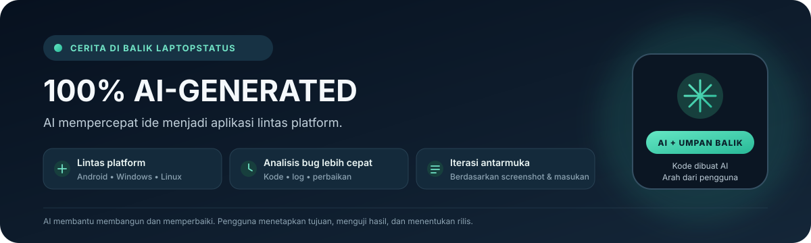

# LaptopStatus





**Bahasa Indonesia** | [English](#english)

---

## Bahasa Indonesia

LaptopStatus membantu memantau dan mengendalikan laptop Windows atau Linux dari ponsel Android. Proyek ini menyediakan aplikasi Android, aplikasi Windows, dan host Linux tahap awal:

- **Aplikasi Windows** (WPF, .NET 8) yang berjalan di laptop.
- **Host Linux** (Python) untuk distro desktop berbasis systemd.
- **Aplikasi Android** (Kotlin) sebagai pendamping di ponsel.

Host Linux tahap awal tersedia di [`LaptopStatus-LinuxApp`](LaptopStatus-LinuxApp/README.md). Host ini memakai ikon tray dan sambungan TLS manual ke Android; fiturnya belum selengkap aplikasi Windows.

Ponsel dapat terhubung ke laptop lewat jaringan lokal, Tailscale, atau Cloudflare Tunnel (opsional), tanpa perlu mengatur port forwarding. Pemasangan perangkat dilakukan dengan pairing melalui kode QR.

### Fitur

Fitur berbeda menurut host yang sedang menjalankan LaptopStatus. Aplikasi Android adalah pengendali; host Windows menyediakan cakupan terlengkap.

**Android ↔ Windows**

- Penemuan laptop di LAN dan pairing QR dengan persetujuan serta kode pencocokan di Windows. Koneksi manual tersedia sebagai pemulihan; koneksi memakai TLS dan sertifikat yang dipasangkan.
- Ringkasan CPU, RAM, baterai, status pengisian, nama/model perangkat, CPU/GPU, dan spesifikasi sistem. Sensor yang tidak disediakan perangkat/driver tidak ditampilkan sebagai data nyata.
- Daftar proses Windows dengan pencarian, pengurutan, filter **Semua / Bisa dihentikan / Dilindungi**, pemakaian RAM, dan permintaan untuk menghentikan proses. Proses terlindungi tidak dapat dihentikan dari daftar.
- Statistik Windows mencakup grafik performa CPU, ringkasan RAM dan proses, rincian modul RAM bila dilaporkan firmware, serta GPU/jaringan bila sensor dan driver menyediakan datanya. Halaman Rincian menampilkan model CPU/GPU, sistem operasi, arsitektur, dan perangkat.
- Lima aksi memori/RAMMap Windows di menu **Bersihkan cache RAM** pada tab **Detail**: kosongkan working sets, system working set, modified page list, standby list, atau standby priority 0. Aplikasi tidak meminta UAC untuk aksi ini; Windows dapat menolak aksi yang dibatasi izin sistem. Pengosongan memori dapat membuat aplikasi memuat ulang halaman dan terasa lambat sementara.
- Permintaan tampilan layar laptop, pratinjau langsung, layar penuh lanskap, pengiriman teks, serta tombol untuk menghentikan sesi. Secara bawaan Windows meminta persetujuan lokal; akses password LaptopStatus opsional, dibatasi percobaan, dan sesi berhenti otomatis setelah 10 menit.
- Terminal jarak jauh PowerShell/Command Prompt Windows. Mulai dari tab **Detail → Terminal**; akses memakai password khusus layar LaptopStatus yang disimpan di Windows dan berjalan dengan hak pengguna Windows biasa. Hentikan sesi saat selesai; perintah administrator tetap mengikuti izin Windows.
- Berbagi file dan clipboard antara Windows dan Android, dengan pemilih file/area seret-lepas di Windows.
- Matikan, mulai ulang, dan tidur dengan konfirmasi serta hitung mundur 10 detik. Pembatalan countdown Windows dapat dilindungi password khusus LaptopStatus. Android juga dapat mengirim pesan khusus yang ditampilkan di Windows.
- Jadwal daya satu kali dan tiga rutinitas bawaan (matikan malam, tidur siang hari kerja, dan mulai ulang mingguan). Rutinitas perlu aplikasi Windows aktif pada waktunya; jadwal sekali jalan dikelola host Windows.
- Pengingat istirahat Windows bersifat opsional: setelah 60 menit muncul pengingat; setelah tiga kali diabaikan, pengingat berikutnya memulai countdown shutdown 10 detik yang masih dapat dibatalkan.
- Riwayat koneksi, baterai, dan aktivitas; troubleshooting koneksi dengan log yang dapat disalin, disimpan, dibagikan, atau dikirim ke PC.
- Aplikasi Windows dapat disembunyikan ke system tray saat jendela ditutup; tray menyediakan status, akses kembali ke jendela, serta menu keluar. Pengingat istirahat dan notifikasi koneksi/jadwal dapat tampil di Windows.
- Konsol debug Windows adalah alat terpisah untuk menguji API perangkat yang sudah dipasangkan: status, RAM, proses, jadwal/rutinitas, berbagi, layar, RAMMap, Joke, daya, pembukaan Notepad/kalkulator, penghentian LaptopStatus, dan sesi terminal. Permintaan POST menampilkan konfirmasi sebelum dikirim.
- Kunci aplikasi Windows dengan dua pilihan terpisah: password dan pertanyaan keamanan. Saat aktif, LaptopStatus meminta autentikasi saat berpindah ke aplikasi Windows lain, termasuk aplikasi yang sudah terbuka. Pertanyaan/jawaban dapat diatur dari Android atau Windows. Kedua metode tetap tersimpan setelah restart dan dapat dipakai bersamaan.
- Mode Joke adalah simulasi layar penuh yang diberi label, dapat dikustomisasi dari Windows, dan berhenti otomatis setelah 30 detik. Ini bukan kendali atau perubahan sistem.
- Koneksi jarak jauh lewat Tailscale atau Cloudflare Tunnel. Tailscale perlu dipasang dan masuk ke akun yang sama pada kedua perangkat. Cloudflare Tunnel dapat memakai login otomatis atau token/hostname; tunnel berjalan selama aplikasi Windows hidup.

**Fitur aplikasi Android**

- Lima tab: **Perangkat** (status, layar, berbagi, daya), **Riwayat**, **Detail** (memori, hardware, proses, log, terminal), **Jadwal**, dan **Akun**. Tab Detail juga memiliki tombol untuk menutup LaptopStatus di PC.
- Pemantauan latar belakang dengan notifikasi status, sakelar peringatan baterai rendah dan nada koneksi, tema klasik, animasi gerak, pilihan gaya dan perlambatan animasi toggle, serta Mode Joke overlay opsional.
- Panduan awal/Tailscale, pemulihan UI dan animasi lama, pengaturan gaya gerak, dan halaman Tentang.
- Pintasan launcher dan integrasi AppFunctions untuk membaca status/mencari proses atau membuka halaman. Permintaan tindakan dari Assistant tetap membuka aplikasi dan meminta konfirmasi pengguna; Assistant tidak dapat langsung mematikan laptop, mengakhiri proses, atau mengendalikan layar.

**Fitur host Linux (awal)**

- Status CPU/RAM/baterai dan sistem, daftar proses, shutdown/restart/tidur melalui systemd, terminal Bash/POSIX, ikon tray, serta koneksi TLS manual.
- Pairing QR, kendali layar, GPU, file/clipboard, jadwal, Mode Joke, dan integrasi Cloudflare Tunnel belum tersedia pada host Linux. Tailscale dapat dipakai melalui koneksi manual bila sudah berjalan di kedua perangkat dan alamat tailnet dapat dijangkau. Rincian dependensi ada di [`LaptopStatus-LinuxApp/README.md`](LaptopStatus-LinuxApp/README.md).

Antarmuka utama tersedia dalam Bahasa Indonesia. Pengukuran hardware bergantung pada sensor, driver, dan data yang dilaporkan firmware.

### Unduh

Unduh versi terbaru di halaman **Releases**:

**https://github.com/myske40/Laptopstatus/releases/latest**

README ini menjelaskan fitur di branch `main`. Perbaikan alur koneksi Android setelah tag v1.18.24 dijelaskan di [CHANGELOG.md](CHANGELOG.md); aset APK v1.18.24 pada halaman Releases dibuat sebelum perbaikan tersebut.

| Berkas | Keterangan |
|---|---|
| `LaptopStatus-Android-<versi>.apk` | Aplikasi Android |
| `LaptopStatus-Windows-<versi>-Portable.zip` | Aplikasi Windows portabel (tanpa instalasi) |
| `LaptopStatus-Setup-<versi>.exe` | Installer Windows |
| `LaptopStatus-DebugConsole-<versi>.exe` | Konsol debug Windows untuk memeriksa API LaptopStatus yang sudah dipasangkan |
| `LaptopStatus-Linux-<versi>-source.zip` | Host Linux dan panduan pemasangan |
| `Source code (zip)` | Kode sumber, dibuat otomatis oleh GitHub |

### Cara pakai

**Di laptop (Windows)**

1. Unduh `LaptopStatus-Setup-<versi>.exe` dari Releases dan jalankan. Jika Windows SmartScreen muncul, pilih **More info → Run anyway**. Alternatifnya, ekstrak ZIP portabel lalu jalankan `LaptopStatus.exe`.
2. Izinkan LaptopStatus pada Windows Firewall untuk jaringan **Private** ketika diminta. Jangan izinkan jaringan publik.
3. Ikuti panduan pertama untuk memilih koneksi. Untuk koneksi lokal, hubungkan Android dan laptop ke Wi-Fi yang sama; Cloudflare/Tailscale dipakai bila perlu koneksi dari luar jaringan.
4. Buka halaman pairing di aplikasi Windows dan siapkan QR untuk dipindai dari Android.

**Di ponsel (Android)**

1. Unduh `LaptopStatus-Android-<versi>.apk` dari Releases.
2. Buka berkas APK. Jika diminta, izinkan browser atau pengelola berkas tersebut memasang aplikasi dari sumber ini, lalu selesaikan pemasangan.
3. Buka LaptopStatus dan pindai QR dari Windows. Cocokkan kode pairing di ponsel dan laptop, lalu setujui permintaan pada aplikasi Windows.
4. Setelah terhubung, gunakan halaman Perangkat untuk status, proses, terminal, dan kontrol yang tersedia.

**Di laptop (Linux)**

1. Unduh dan ekstrak `LaptopStatus-Linux-0.1.0-source.zip`. Ikuti perintah dependensi yang sesuai untuk Ubuntu/Debian, Fedora, atau Arch di [`LaptopStatus-LinuxApp/README.md`](LaptopStatus-LinuxApp/README.md).
2. Dari terminal, masuk ke folder hasil ekstrak dan jalankan `bash install.sh`. Buka **LaptopStatus** dari menu aplikasi.
3. Klik ikon tray **LaptopStatus → Sambungkan Android…**. Biarkan aplikasi Linux berjalan dan hubungkan ponsel ke jaringan lokal yang sama.
4. Di Android, tambahkan koneksi manual menggunakan alamat IPv4, token pairing, dan fingerprint TLS yang ditampilkan oleh ikon tray. Masukkan password terminal Linux saat membuka terminal.

Host Linux tahap awal ditujukan untuk distro desktop berbasis systemd seperti Ubuntu, Debian, Fedora, dan Arch. Kendali layar, QR pairing, Cloudflare Tunnel, dan telemetry GPU belum didukung di Linux. Tailscale perlu disambungkan secara manual.

> **Catatan Windows:** karena aplikasi ini bukan dari Microsoft Store, Windows SmartScreen bisa menampilkan peringatan. Klik **More info**, lalu **Run anyway**.

### Menggunakan dan menonaktifkan fitur

**Menghubungkan dan memutuskan**

1. Jalankan LaptopStatus di Windows. Di Android buka **Perangkat** lalu tekan **Hubungkan** untuk mencari laptop. Pilih laptop yang ditemukan. Untuk pairing QR tekan **Pindai QR** dan setujui kode yang sama di Windows. **Atur manual** dipakai jika penemuan otomatis tidak tersedia.
2. Setelah terhubung, status dan aksi memakai data dari host. Jika laptop tidak muncul, pastikan aplikasi Windows berjalan, kedua perangkat satu Wi-Fi, dan Windows Firewall mengizinkan jaringan privat.
3. Android **Akun → Putuskan laptop** memutus koneksi ponsel saat ini. Untuk menghentikan host dan semua koneksi, pilih **Pengaturan Windows → Keluar dari LaptopStatus** atau gunakan **Keluar** pada menu ikon tray. Menutup jendela Windows biasa hanya menyembunyikannya ke tray.

**Menggunakan tab Android setelah pairing**

| Tab | Yang dapat dilakukan |
|---|---|
| **Perangkat** | Lihat status CPU/RAM/baterai; tekan **Minta layar** untuk meminta sesi layar; kirim teks/file/clipboard; pilih Matikan, Mulai ulang, atau Tidur untuk melihat konfirmasi dan hitung mundur. Windows harus aktif dan beberapa tindakan memerlukan persetujuan/password. |
| **Riwayat** | Pilih **Semua**, **Koneksi**, atau **Baterai**; tekan **Hapus riwayat** untuk menghapus aktivitas yang tersimpan di Android. |
| **Detail** | **Memori** menunjukkan pemakaian dan menyediakan aksi RAMMap; **Perangkat** menunjukkan spesifikasi; **Proses** menyediakan cari/filter/urutkan, penghentian yang diizinkan, dan tombol **Paksa tutup LaptopStatus di PC**; **Log** menjalankan pemeriksaan koneksi dan menyediakan aksi salin/simpan/bagikan/kirim. **Terminal** membuka PowerShell atau Command Prompt Windows. |
| **Jadwal** | Pilih Matikan/Mulai ulang/Tidur dan waktu, lalu simpan jadwal sekali jalan; gunakan switch untuk menyalakan atau mematikan rutinitas berulang. |
| **Akun** | Atur pemantauan latar, peringatan baterai, nada koneksi, tema/animasi, dan overlay Joke; putuskan koneksi atau buka panduan. |

**Pakai koneksi dari luar Wi-Fi**: untuk Tailscale, pasang lalu masuk ke akun yang sama di Windows dan Android, kemudian pindai QR Windows. Untuk Cloudflare, buka Pengaturan Windows dan gunakan **Login Cloudflare & buat tunnel otomatis** atau isi hostname/token lalu simpan; nyalakan tunnel dari Ringkasan, kemudian pindai QR yang menampilkan alamat tunnel.

Di Windows, halaman **Ringkasan** menampilkan metrik, alamat/kunci, QR, koneksi tunnel, dan panel berbagi. Klik kartu CPU/RAM/baterai untuk membuka rincian terkait. Sidebar membuka **Statistik** (proses/performa/RAMMap), **Rincian perangkat**, **Riwayat**, dan **Pengaturan** (tampilan, koneksi, pengingat, kunci aplikasi, Joke, serta akses layar). Gunakan tab **Kunci aplikasi** di Pengaturan untuk mengatur pertanyaan dan jawaban.

**Menonaktifkan sakelar dan proteksi**

| Yang ingin dimatikan | Caranya |
|---|---|
| Pemantauan/layanan latar Android | Android → **Akun** → matikan **Pantau di latar belakang**. Ini menghentikan pemantauan latar, bukan aplikasi Windows. |
| Peringatan baterai rendah / nada koneksi | Android → **Akun** → matikan sakelar masing-masing. Nada koneksi Windows juga dapat dimatikan dari **Windows → Pengaturan → Koneksi & pemberitahuan**. |
| Mode Joke di aplikasi Android lain | Android → **Akun** → matikan **Mode Joke di aplikasi lain**. Jika sedang tampil, gunakan **Hentikan joke Android** di Pengaturan Windows atau tunggu simulasi berakhir. |
| Kunci aplikasi Windows dengan password | Android → **Detail** atau Windows → **Pengaturan → Kunci aplikasi** → matikan **Kunci dengan password**. Password ini adalah password khusus LaptopStatus, bukan password akun Windows. |
| Kunci aplikasi Windows dengan pertanyaan | Android → **Detail** atau Windows → **Pengaturan → Kunci aplikasi** → matikan **Kunci dengan pertanyaan keamanan**. Untuk menonaktifkan seluruh kunci aplikasi, matikan **kedua** sakelar password dan pertanyaan. |
| Akses layar / terminal / pembatalan countdown dengan password | Jika kunci aplikasi password aktif, matikan dulu sakelar **Kunci dengan password**. Lalu Windows → **Pengaturan → Akses layar dengan password LaptopStatus**; matikan **Izinkan sesi password tanpa popup** dan tekan **Simpan pengaturan akses**. Ini mematikan akses layar dan terminal dengan password serta pembatalan countdown memakai password; permintaan layar kembali memerlukan persetujuan langsung di laptop. |
| Sesi kendali layar yang sedang berjalan | Tekan **Stop layar** di Android atau hentikan sesi dari indikator LaptopStatus di Windows. Sesi juga berakhir otomatis maksimal 10 menit. |
| Sesi terminal jarak jauh | Tekan **Hentikan** di tab **Detail → Terminal**, atau putuskan Android/keluar dari host Windows. Terminal berjalan sebagai pengguna Windows biasa, bukan elevated. |
| Jadwal daya sekali jalan | Android → **Jadwal**, pilih jadwal aktif lalu **Batalkan**. Rutinitas berulang dimatikan lewat sakelar pada masing-masing rutinitas. |
| Cloudflare Tunnel | Windows → **Ringkasan** → tekan tombol tunnel yang sama saat statusnya aktif untuk mematikannya. Koneksi LAN/Tailscale tetap terpisah. |
| Coba LAN/Tailscale otomatis | Windows → **Pengaturan → Koneksi & pemberitahuan** → matikan **Coba LAN dan Tailscale otomatis**. Ini hanya mematikan pemilihan rute otomatis. |
| Tailscale sepenuhnya | Matikan Tailscale atau keluar dari akun Tailscale di salah satu perangkat. Mematikan pemilihan rute otomatis di LaptopStatus saja tidak menghentikan aplikasi Tailscale. |
| Pengingat istirahat (termasuk countdown shutdown) | Windows → **Pengaturan → Pengingat istirahat** → matikan **Ingatkan saya untuk istirahat**. Pengingat ini mati secara bawaan. |
| Joke/suara notifikasi Android saat aplikasi dibuka | Windows → **Pengaturan → Koneksi & pemberitahuan** → matikan sakelar Joke dan suara notifikasi Android. |
| Tampilan/animasi | Android → **Akun** untuk animasi, tema, dan gaya toggle; Windows → **Pengaturan → Tampilan** untuk animasi, tema klasik, atau gaya Claude. |
| Konsol debug | Tutup aplikasi **LaptopStatus Debug Console**. Aplikasi ini tidak berjalan sebagai layanan latar. |

Fitur kontrol daya, terminal, penghentian proses, RAMMap, berbagi, dan kendali layar tidak berjalan jika Android belum tersambung ke host yang sesuai. Pada Windows, rutinitas berulang juga tidak akan berjalan jika aplikasi host tidak aktif saat jadwal tiba.

**Memakai konsol debug Windows**

1. Buka `LaptopStatus-DebugConsole-<versi>.exe` di laptop yang sama dengan host (alamat awal `127.0.0.1`) atau isi alamat host Windows yang dipasangkan.
2. Masukkan port API (biasanya `8765`; kendali layar memakai `8767`), kunci pairing, dan fingerprint TLS SHA-256 dari Pengaturan Windows. Tekan **Periksa koneksi**.
3. Pilih preset untuk membaca status, memori, proses, jadwal, atau rutinitas. Aksi POST meminta konfirmasi dan dapat mengubah keadaan laptop; gunakan hanya pada perangkat sendiri. Path API dan body JSON juga dapat disunting untuk diagnosis.

### Membangun dari kode sumber

**Aplikasi Windows**

Prasyarat: Windows, [.NET 8 SDK](https://dotnet.microsoft.com/download/dotnet/8.0).

```bash
cd LaptopStatus-WindowsApp
dotnet build -c Release
```

**Aplikasi Android**

Prasyarat: JDK 17 dan Android SDK.

```bash
cd LaptopStatus-AndroidApp
./gradlew assembleRelease
```

APK hasil build tidak bertanda tangan. Tandatangani dengan keystore milikmu sendiri sebelum dipasang atau dibagikan.

### Struktur repositori

```
LaptopStatus-WindowsApp/   Aplikasi Windows (WPF, .NET 8)
LaptopStatus-AndroidApp/   Aplikasi Android (Kotlin)
LaptopStatus-LinuxApp/     Host Linux (Python, tahap awal)
LaptopStatus-Setup/        Proyek installer Windows
```

### Keamanan

- Jangan membagikan kode QR pairing kepada orang lain.
- Fitur seperti terminal jarak jauh dan kontrol daya memberi akses penuh ke laptop. Pasang hanya di perangkat milikmu sendiri.
- Jangan pernah memasukkan keystore, sertifikat `.pfx`, atau token ke repositori.

### Lisensi

LaptopStatus dilisensikan di bawah [MIT License](LICENSE). Lisensi ini mengizinkan penggunaan, perubahan, dan distribusi dengan mempertahankan pemberitahuan hak cipta dan lisensi.

### Dibuat dengan AI

> # 100% AI-GENERATED
>
> Kode aplikasi, antarmuka, dan dokumentasi proyek ini dihasilkan dengan bantuan AI. Pengguna memberikan tujuan, kebutuhan fitur, tangkapan layar, laporan bug, serta umpan balik pengujian dan menentukan keputusan rilis.

AI dipakai agar pengembangan lintas Android, Windows, dan Linux lebih cepat; membantu membaca log dan mencari penyebab bug; serta mempercepat iterasi UI dari laporan dan tangkapan layar. Pengujian pada perangkat dan keputusan produk tetap ditinjau manusia.

#### Transkrip ringkas proses pembuatan

Ini ringkasan alur pengembangan, bukan salinan kata demi kata dari percakapan:

1. **Pengguna:** Menjelaskan kebutuhan memantau dan mengendalikan laptop dari Android, termasuk koneksi, terminal, kontrol daya, dan aplikasi desktop.
2. **AI:** Menyusun struktur aplikasi Android, Windows, lalu host Linux; menambahkan pairing TLS, API perangkat, serta alur pemasangan dan penggunaan.
3. **Pengguna:** Mengirim tangkapan layar, laporan tampilan terpotong, notifikasi berulang, crash, serta perilaku shutdown dan tray yang tidak sesuai.
4. **AI:** Memeriksa kode dan log Windows, memperbaiki alur koneksi, notifikasi, tray fallback, riwayat, layout, serta proses build.
5. **Pengguna:** Meninjau hasil di perangkat dan mengarahkan perubahan berikutnya. **AI:** Memperbarui implementasi, dokumentasi, dan paket uji berdasarkan umpan balik itu.
6. **Pengguna:** Menyetujui kapan dokumentasi dan rilis GitHub diperbarui. AI tidak menerbitkan rilis sebelum persetujuan tersebut.

---

<a id="english"></a>

## English

LaptopStatus helps you monitor and control a Windows or Linux laptop from an Android phone. The project includes an Android app, a Windows app, and an early Linux host:

- A **Windows app** (WPF, .NET 8) that runs on the laptop.
- An **Android app** (Kotlin) that runs on the phone as a companion.
- An **early Linux host** (Python) for systemd-based desktop distributions.

The phone can connect to the laptop over a local network, Tailscale, or an optional Cloudflare Tunnel without port forwarding. Devices are paired with a QR code.

The Linux host is in [`LaptopStatus-LinuxApp`](LaptopStatus-LinuxApp/README.md). It uses a tray icon and manual TLS pairing with Android; feature coverage is still limited compared with Windows.

### Features

Features vary by host. The Android app is the controller; Windows provides the broadest feature set.

**Android ↔ Windows**

- Discover laptops on a local network and pair by QR code with Windows approval and a matching code. Manual connection is available as a recovery option. Connections use TLS and a paired certificate.
- Read CPU, RAM, battery and charging status, device name/model, CPU/GPU, and system specifications. Sensors that the device, driver, or firmware does not report are not shown as real measurements.
- Browse Windows processes with search, sorting, **All / Can stop / Protected** filters, RAM usage, and process termination requests. Protected processes cannot be stopped from this list.
- Windows statistics include CPU performance graphs, RAM and process summaries, RAM module details when reported by firmware, and GPU/network readings when sensors and drivers provide them. Device details show CPU/GPU model, operating system, architecture, and hardware.
- Five Windows memory/RAMMap actions are under **Clear RAM cache** on the **Details** tab: clear working sets, system working set, modified page list, standby list, or standby priority 0. The app does not request UAC for these actions; Windows may reject actions restricted by system permissions. Clearing memory may make apps reload pages and feel slower temporarily.
- Request the laptop screen, view a live preview, use landscape full-screen, send text, and stop the session. Windows approval is required by default. Optional LaptopStatus password access is rate-limited and sessions end automatically after 10 minutes.
- Remote Windows PowerShell/Command Prompt terminal. Start it from **Details → Terminal**; access uses the dedicated LaptopStatus screen password configured in Windows and runs with normal Windows-user rights. Stop the session when finished; administrator commands remain subject to Windows permissions.
- Share files and clipboard between Windows and Android using the Windows file picker or drag-and-drop area.
- Shut down, restart, or sleep with confirmation and a 10-second countdown. Windows countdown cancellation can require a dedicated LaptopStatus password. Android can also send a custom message to show on Windows.
- One-time power schedules and three built-in routines (night shutdown, weekday nap, and weekly restart). Recurring routines require the Windows app to be running at the scheduled time; one-time schedules are managed by the Windows host.
- Optional Windows break reminders: the first prompt appears after 60 minutes; after three ignored prompts, the next starts a cancellable 10-second shutdown countdown.
- Connection, battery, and activity history; connection troubleshooting with logs that can be copied, saved, shared, or sent to the PC.
- Windows can minimize to the system tray when its window closes; the tray provides status, a way back to the window, and an exit menu. Break reminders and connection/schedule notifications can appear on Windows.
- A separate Windows Debug Console can inspect the paired device API: status, RAM, processes, schedules/routines, sharing, screen, RAMMap, Joke, power, Notepad/calculator launch, LaptopStatus exit, and a terminal session. POST requests require confirmation.
- Lock Windows apps using two separate options: password and security question. When enabled, LaptopStatus requests authentication when switching to another Windows app, including one that was already open. Set the question/answer from Android or Windows. Both options persist across restarts and can be enabled together.
- Joke Mode is a clearly labelled full-screen simulation, customizable from Windows, and ends automatically after 30 seconds. It does not control or change the system.
- Remote connectivity through Tailscale or Cloudflare Tunnel. Tailscale must be installed and signed in on both devices with the same account. Cloudflare Tunnel can use browser login or a hostname/token and runs while the Windows app is open.

**Android app features**

- Five tabs: **Device** (status, screen, sharing, power), **History**, **Details** (memory, hardware, processes, logs, terminal), **Schedule**, and **Account**. The Details tab also has a button to close LaptopStatus on the PC.
- Background monitoring with status notifications; separate low-battery and connection-sound switches; classic theme, motion animation, toggle animation style, and optional Joke Mode overlay.
- Launcher shortcuts and AppFunctions integration to read status/search processes or open a page. Assistant control requests still open the app and require user confirmation; Assistant cannot directly shut down the laptop, terminate processes, or control the screen.

**Early Linux host**

- CPU/RAM/battery and system status, process list, shutdown/restart/sleep through systemd, Bash/POSIX terminal, tray icon, and manual TLS connection.
- QR pairing, screen control, GPU, file/clipboard sharing, schedules, Joke Mode, and Cloudflare Tunnel integration are not available on the Linux host. Tailscale can be used through a manual connection if it is running on both devices and the tailnet address is reachable. See [`LaptopStatus-LinuxApp/README.md`](LaptopStatus-LinuxApp/README.md) for dependencies.

The primary interface is available in Indonesian. Hardware readings depend on available sensors, drivers, and firmware-reported data.

### Download

Get the latest version from the **Releases** page:

**https://github.com/myske40/Laptopstatus/releases/latest**

This README describes the `main` branch. The Android connection-flow fix after tag v1.18.24 is documented in [CHANGELOG.md](CHANGELOG.md); the v1.18.24 APK assets on the Releases page were built before that fix.

| File | Description |
|---|---|
| `LaptopStatus-Android-<version>.apk` | Android app |
| `LaptopStatus-Windows-<version>-Portable.zip` | Portable Windows app (no installation) |
| `LaptopStatus-Setup-<version>.exe` | Windows installer |
| `LaptopStatus-DebugConsole-<version>.exe` | Windows debug console for inspecting a paired LaptopStatus API |
| `LaptopStatus-Linux-<version>-source.zip` | Linux host and installation guide |
| `Source code (zip)` | Source code, generated automatically by GitHub |

### Getting started

**On the laptop (Windows)**

1. Download `LaptopStatus-Setup-<version>.exe` from Releases and run it. If Windows SmartScreen appears, choose **More info → Run anyway**. Alternatively, extract the portable ZIP and run `LaptopStatus.exe`.
2. Allow LaptopStatus through Windows Firewall for **Private** networks only when prompted. Do not allow public networks.
3. Follow the first-run guide to choose a connection. For local access, connect Android and the laptop to the same Wi-Fi; use Cloudflare/Tailscale when you need access from another network.
4. Open pairing in the Windows app and display its QR code.

**On the phone (Android)**

1. Download `LaptopStatus-Android-<version>.apk` from Releases.
2. Open the APK. If prompted, allow the browser or file manager to install apps from this source, then finish installation.
3. Open LaptopStatus and scan the Windows QR code. Compare the pairing code on both devices, then approve the request in the Windows app.
4. After connecting, use the Device page for status, processes, terminal, and available controls.

**On Linux**

1. Download and extract `LaptopStatus-Linux-0.1.0-source.zip`. Follow the Ubuntu/Debian, Fedora, or Arch dependency commands in [`LaptopStatus-LinuxApp/README.md`](LaptopStatus-LinuxApp/README.md).
2. Open a terminal in the extracted folder and run `bash install.sh`. Launch **LaptopStatus** from the application menu.
3. Select **Sambungkan Android…** from the LaptopStatus tray icon. Keep the Linux host running and connect the phone to the same local network.
4. In Android, add a manual connection with the IPv4 address, pairing token, and TLS fingerprint shown by the tray icon. Enter the Linux terminal password when opening a terminal.

The early Linux host targets systemd desktop distributions such as Ubuntu, Debian, Fedora, and Arch. Screen control, QR pairing, Cloudflare Tunnel, and GPU telemetry are not available on Linux yet. Tailscale must be configured manually.

> **Windows note:** because the app is not distributed through the Microsoft Store, Windows SmartScreen may show a warning. Click **More info**, then **Run anyway**.

### Using and disabling features

**Connect and disconnect**

1. Run LaptopStatus on Windows. In Android, open **Device** and press **Connect** to search for laptops, then select one. For QR pairing, press **Scan QR** and approve the matching code in Windows. **Manual setup** is available when automatic discovery cannot be used.
2. After connecting, status and actions use data from the host. If the laptop is not listed, make sure the Windows app is running, both devices are on the same Wi-Fi, and Windows Firewall allows private networks.
3. Android **Account → Disconnect laptop** disconnects the current phone. To stop the Windows host and all connections, choose **Windows Settings → Exit LaptopStatus** or **Exit** from its tray menu. Closing the Windows window normally only minimizes it to the tray.

**Using the Android tabs after pairing**

| Tab | What it does |
|---|---|
| **Device** | View CPU/RAM/battery status; press **Request screen** to request a screen session; send text/files/clipboard; select Shut down, Restart, or Sleep to review the confirmation and countdown. Windows must be active, and some actions need approval/password. |
| **History** | Filter **All**, **Connection**, or **Battery**; press **Clear history** to delete activity records stored on Android. |
| **Details** | **Memory** shows usage and RAMMap actions; **Device** shows specifications; **Processes** supports search/filter/sort, permitted termination, and **Force close LaptopStatus on PC**; **Log** runs connection diagnostics and can copy/save/share/send logs. **Terminal** opens Windows PowerShell or Command Prompt. |
| **Schedule** | Choose Shut down/Restart/Sleep and a time, then save a one-time schedule; use each switch to enable or disable a recurring routine. |
| **Account** | Set background monitoring, battery alerts, connection sounds, theme/animation (including 3× slower toggle animation), and Joke overlay; disconnect or open help. |

**Connect from outside the Wi-Fi network**: for Tailscale, install it and sign into the same account on Windows and Android, then scan the Windows QR code. For Cloudflare, open Windows Settings and choose **Login Cloudflare & buat tunnel otomatis**, or enter a hostname/token and save; enable the tunnel from Summary, then scan a QR code that includes the tunnel address.

On Windows, **Summary** shows metrics, address/key, QR, tunnel connection, and sharing. Click CPU/RAM/battery cards to open related details. The sidebar opens **Statistics** (processes/performance/RAMMap), **Device details**, **History**, and **Settings** (appearance, connection, reminders, app lock, Joke, and screen access). Use the **App lock** section in Settings to configure a security question and answer.

**Turn off switches and protections**

| Feature to turn off | How |
|---|---|
| Android background monitoring | Android → **Account** → turn **Background monitoring** off. This stops background monitoring, not the Windows app. |
| Low battery alerts / connection sound | Android → **Account** → turn off each switch. Windows connection sounds can also be disabled in **Windows → Settings → Connection & notifications**. |
| Joke Mode over other Android apps | Android → **Account** → turn **Joke Mode in other apps** off. If it is currently showing, choose **Stop Android Joke** in Windows Settings or wait for the simulation to end. |
| Windows app lock by password | Android → **Details** or Windows → **Settings → App lock** → turn **Lock with password** off. This is the dedicated LaptopStatus password, not the Windows account password. |
| Windows app lock by question | Android → **Details** or Windows → **Settings → App lock** → turn **Lock with security question** off. Turn **both** password and question switches off to disable the app lock entirely. |
| Password-based screen/terminal access and countdown cancellation | If the app-lock password is on, turn **Lock with password** off first. Then Windows → **Settings → LaptopStatus password screen access**; turn **Allow password sessions without a popup** off and click **Save access settings**. This disables password access to screen/terminal and password-based countdown cancellation; screen requests will require laptop approval again. |
| Active screen-control session | Press **Stop screen** on Android or stop it from the LaptopStatus indicator on Windows. A session also ends after at most 10 minutes. |
| Remote terminal session | Press **Stop** on **Details → Terminal**, or disconnect Android/exit the Windows host. The terminal runs as the normal Windows user, not elevated. |
| One-time power schedule | Android → **Schedule**, select the active schedule, then **Cancel**. Turn off recurring routines with their individual switches. |
| Cloudflare Tunnel | Windows → **Summary** → press the same tunnel button while it is active to stop it. LAN and Tailscale connections are separate. |
| Automatic LAN/Tailscale routing | Windows → **Settings → Connection & notifications** → turn off **Try LAN and Tailscale automatically**. This only disables automatic route selection. |
| Tailscale entirely | Turn off Tailscale or sign out of Tailscale on either device. Turning off automatic route selection in LaptopStatus alone does not stop Tailscale. |
| Break reminders (including shutdown countdown) | Windows → **Settings → Break reminder** → turn off **Remind me to take a break**. This feature is off by default. |
| Joke/sound notification when Android opens | Windows → **Settings → Connection & notifications** → turn off the Joke and Android sound notification switch. |
| Appearance and animations | Android → **Account** for animation, theme, toggle style/speed, and the option to restore the previous UI; Windows → **Settings → Appearance** for animations, classic theme, or Claude style. |
| Debug Console | Close the **LaptopStatus Debug Console** app. It does not run as a background service. |

Power, terminal, process termination, RAMMap, sharing, and screen-control actions require Android to be connected to the corresponding host. Recurring Windows routines also need the Windows app running at the scheduled time.

**Using the Windows Debug Console**

1. Open `LaptopStatus-DebugConsole-<version>.exe` on the same laptop as the host (the default address is `127.0.0.1`) or enter the paired Windows host address.
2. Enter the API port (usually `8765`; screen control uses `8767`), pairing key, and the TLS SHA-256 fingerprint from Windows Settings. Click **Periksa koneksi**.
3. Select a preset to read status, memory, processes, schedules, or routines. POST actions require confirmation and can change laptop state; use them only on your own devices. You can edit the API path and JSON body for diagnosis.

### Build from source

**Windows app**

Requirements: Windows and the [.NET 8 SDK](https://dotnet.microsoft.com/download/dotnet/8.0).

```bash
cd LaptopStatus-WindowsApp
dotnet build -c Release
```

**Android app**

Requirements: JDK 17 and the Android SDK.

```bash
cd LaptopStatus-AndroidApp
./gradlew assembleRelease
```

The resulting APK is unsigned. Sign it with your own keystore before installing or sharing it.

### Repository layout

```
LaptopStatus-WindowsApp/   Windows app (WPF, .NET 8)
LaptopStatus-AndroidApp/   Android app (Kotlin)
LaptopStatus-LinuxApp/     Early Linux host (Python)
LaptopStatus-Setup/        Windows installer project
```

### Security

- Do not share the pairing QR code with anyone else.
- Features such as the remote terminal and power control give full access to the laptop. Install the app only on devices you own.
- Never commit keystores, `.pfx` certificates, or tokens to the repository.

### License

LaptopStatus is licensed under the [MIT License](LICENSE). It permits use, modification, and distribution as long as the copyright and license notices are retained.

### Made with AI

> # 100% AI-GENERATED
>
> The app code, interfaces, and project documentation were generated with AI assistance. The user supplied the goals, feature requirements, screenshots, bug reports, and testing feedback, and made product and release decisions.

AI was used to speed up development across Android, Windows, and Linux; help inspect logs and diagnose bugs; and iterate on UI changes from screenshots and reports. A human reviewed device testing and product decisions.

#### Condensed development transcript

This is a summary of the development flow, not a verbatim chat transcript:

1. **User:** Described the need to monitor and control a laptop from Android, including connectivity, terminal, power controls, and desktop apps.
2. **AI:** Set up the Android and Windows apps, followed by an early Linux host; added TLS pairing, device APIs, and installation guidance.
3. **User:** Shared screenshots and reports about clipped layouts, repeated notifications, crashes, and unexpected shutdown and tray behavior.
4. **AI:** Inspected the code and Windows logs, then revised connection handling, notifications, tray fallback, history, layouts, and build steps.
5. **User:** Reviewed results on devices and directed the next changes. **AI:** Updated implementation, documentation, and test packages from that feedback.
6. **User:** Decided when documentation and GitHub releases could be updated. AI did not publish a release before approval.

